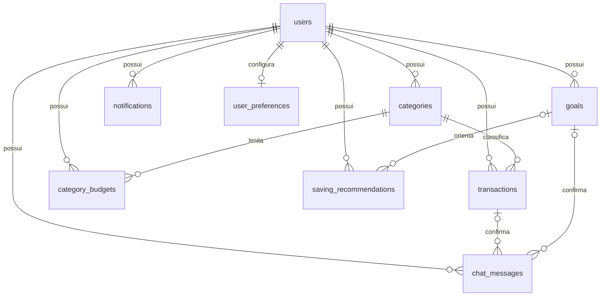

# Etapa 2 — esquema financeiro

Este documento descreve o esquema da etapa 2. A etapa 3 habilitou cadastro/login REST, sessão e perfil; consulte [auth.md](auth.md) para a configuração atual. As migrations financeiras já aplicadas permanecem inalteradas.

Backend: `/mnt/DEV/DEVTEAM/economizou/backend`. Mobile somente consultado em `../frontend/`; seus tipos e dados locais não foram alterados nem importados.

## Shield e tabelas oficiais

O pacote `codeigniter4/shield` 1.4.1 usa suas próprias migrations e seu `UserModel`. Foram criadas `users`, `auth_identities`, `auth_logins`, `auth_token_logins`, `auth_remember_tokens`, `auth_groups_users` e `auth_permissions_users`. Senhas/identidades/tokens pertencem exclusivamente ao Shield. A dependência oficial `codeigniter4/settings` 2.4.0 cria `settings`.

`Config\Auth`, `AuthGroups` e `AuthToken` estendem as configurações oficiais. Helpers `auth` e `setting` estão carregados, e a proteção CSRF de sessão está preparada. A etapa 3 adicionou as rotas REST sem habilitar as páginas HTML do Shield. Não são inseridos usuários de demonstração no banco da aplicação.

## Tabelas financeiras

Todas têm `id BIGINT UNSIGNED`, `user_id INT UNSIGNED` compatível com `users.id` do Shield, `created_at` e `updated_at`. InnoDB e `utf8mb4_unicode_ci` são explícitos. Os horários de auditoria seguem a configuração atual do backend (`America/Sao_Paulo`); datas de transações e meses são datas civis, sem conversão para UTC.

| Tabela / Model | Campos de negócio | Restrições principais |
| --- | --- | --- |
| `categories` / `CategoryModel` | `name`, `type` (`income`/`expense`) | Nome único por dono/tipo, comparação sem distinção de caixa/acentos pela collation; texto normalizado no Model. |
| `transactions` / `TransactionModel` | `category_id`, `type`, `description`, `amount_cents`, `transaction_date` | Categoria deve pertencer ao mesmo usuário e ter o mesmo tipo. Índices por dono/data, dono/tipo/data e dono/categoria/data. |
| `goals` / `GoalModel` | `name`, `target_cents`, `saved_cents` | Objetivo positivo; guardado não negativo, permitindo ultrapassar a meta como no mobile. |
| `category_budgets` / `CategoryBudgetModel` | `category_id`, `period_month`, `limit_cents` | Um limite por dono/categoria/mês; mês é `YYYY-MM-01`; somente categorias de despesa do próprio usuário. |
| `notifications` / `NotificationModel` | `title`, `body`, `notification_date`, `is_read` | Booleano 0/1; índice por dono/leitura/data. |
| `user_preferences` / `UserPreferenceModel` | `display_name`, `avatar`, `hide_amounts`, `notifications_enabled`, `animations_enabled`, `onboarding_completed` | Relação 1:1 com usuário; indicadores 0/1; perfil opcional até ser informado. |
| `chat_messages` / `ChatMessageModel` | `role`, `text`, `proposal_type`, `proposal`, `request`, `status`, `transaction_id`, `goal_id` | JSON válido; propostas/perguntas somente do assistente; proposta e pergunta mutuamente exclusivas; vínculos confirmados ao próprio dono. |
| `saving_recommendations` / `SavingRecommendationModel` | `title`, `description`, `status`, `goal_id` opcional | Status `pending`/`accepted`/`ignored`; meta vinculada deve ser do mesmo usuário. |

Valores monetários usam **BIGINT em centavos**, sem FLOAT/DOUBLE/DECIMAL. O limite por campo é `9007199254740991`, compatível com a precisão inteira dos tipos TypeScript existentes. `amount_cents`, `target_cents` e `limit_cents` são positivos; `saved_cents` aceita zero. Regras PHP recusam floats, booleanos, notação científica, valores negativos e datas civis inválidas. As restrições SQL reforçam essas regras mesmo em acessos administrativos que não usam Models.

`category_budgets` ainda não existe no modelo local do mobile; foi definido como limite mensal por categoria de despesa, sem modificar o app. `display_name`/`avatar` e `onboarding_completed` acomodam os campos hoje guardados no perfil/onboarding local.

## Relacionamentos e exclusão



As FKs compostas incluem `user_id`, e a de categoria de Transação inclui também `type`. Portanto, nem um SQL administrativo consegue vincular uma Transação à categoria de outro dono/tipo. Exclusões/alterações de chaves usam **RESTRICT**, preservando registros referenciados. O soft delete dos usuários continua sendo o mecanismo oficial do Shield; limpeza física de dados financeiros não foi implementada. A migration antiga e os volumes Docker foram mantidos.

## Uso seguro dos Models

Os Models estendem o Model do CodeIgniter e resolvem o usuário exclusivamente por `auth()` do Shield a cada operação. Sem autenticação, falham fechados. `find`, `findAll`, `first`, `findColumn`, `paginate` e `countAllResults` incluem o dono; `update`/`delete` exigem IDs pertencentes a ele. Campos `user_id`, `created_at` e `updated_at` enviados pelo cliente não são usados. O mesmo objeto de Model pode ser reutilizado depois de trocar a sessão sem manter o escopo do usuário anterior.

Por segurança, Query Builder direto, troca de tabela, `set()`, `replace()` e operações em lote não são uma interface suportada desses Models. Novos filtros REST devem ser implementados como métodos específicos, mantendo o escopo obrigatório. SQL via `db_connect()` é administrativo e **não** possui isolamento de leitura por linha no MariaDB; não deve receber consultas de usuários. Os futuros controllers ainda precisarão do filtro Shield e do tratamento apropriado dos erros de validação/constraints.

IDs locais do Expo são strings e os IDs do banco são gerados no servidor. Não há sincronização automática entre eles. A próxima etapa deve implementar DTOs para `camelCase`/`snake_case`, serialização precisa de IDs/centavos e tradução de `proposal`/`goalProposal` para `proposal_type` + `proposal`. Os JSONs de proposta/contexto são snapshots; seus dados devem ser revalidados e seus IDs traduzidos antes de qualquer confirmação futura. Não registram transações automaticamente.

## Migrations e testes

```bash
cd /mnt/DEV/DEVTEAM/economizou/backend
docker compose exec app php spark migrate --all
docker compose exec app php spark migrate:status

# Teste isolado, sem apagar volumes:
docker compose -f docker-compose.yml -f docker-compose.test.yml up -d --wait db-test
docker compose exec app composer test
```

O bootstrap PHPUnit aceita apenas `testing` + grupo `tests` + host `db-test` + banco/usuário `economizou_test`, e confere `SELECT DATABASE()` antes de executar migrations. Esse container usa `tmpfs`, sem portas públicas e sem volumes de desenvolvimento. Os testes fazem rollback completo e reaplicação **somente nesse banco**. Nenhum rollback foi executado no grupo `default`.

A migration financeira verifica dependências e recusa tabelas já existentes em vez de recriá-las. Como o DDL do MariaDB não é transacional para um conjunto de tabelas, uma interrupção durante a primeira aplicação deve ser diagnosticada antes de tentar novamente; não há limpeza automática destrutiva. Em execuções normais, o controle de migrations evita reaplicar o que já foi executado.

Referências: [Shield](https://github.com/codeigniter4/shield), [migrations do CodeIgniter](https://codeigniter4.github.io/userguide/dbmgmt/migration.html).

## Complemento de perfil — 13/11/2026

A migration `2026-11-13-000004_AddProfilePersonalization` acrescenta campos à tabela existente `user_preferences`:

| Campo | Tipo | Uso |
| --- | --- | --- |
| `birth_date` | DATE, opcional | Data civil válida de 1900 até hoje; não calcula idade |
| `financial_objective` | VARCHAR(30), opcional | `organize`, `save`, `debt_free` ou `achievement` |
| `monthly_income_cents` | BIGINT, opcional | Renda de planejamento, de 0 a 9007199254740991 centavos |
| `personalization_completed` | TINYINT, padrão 1 | Contas existentes seguem normalmente; novo cadastro grava 0 |

Restrições CHECK validam renda, opções e flag. Nascimento e demais campos são validados pelo endpoint e Model antes da gravação. A FK/índice único por usuário e a auditoria existentes são preservados. Null remove um opcional; omissão no PATCH preserva o valor anterior. Não há duplicação de `users`, senha própria ou Transação criada a partir da renda. Veja [contrato do perfil](auth.md#cadastro-e-personalização--13112026).

## Categorias sincronizadas

A migration complementar `2026-11-13-000005_AddCategorySynchronization` acrescenta `categories.client_key VARCHAR(128) NULL`, `deleted_at DATETIME NULL` e o índice único `(user_id, client_key)`. Mantém a tabela, dados anteriores, unicidade de nomes por usuário/tipo e FKs. O Model reutiliza o escopo fechado do Shield e exclusão lógica, bloqueando exclusão de categorias já usadas por transações/limites no banco. Consulte [categories.md](categories.md).
